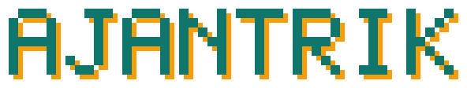
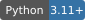

<p align="center">
  
</p>

<p align="center">
  
</p>

<h1 align="center">Ajantrik</h1>

<h3 align="center">A configurable software factory.</h3>

<p align="center">
  AI agents that take a ticket from spec to pull request. One <code>factory.yaml</code> plus markdown
  agents and skills defines the whole loop, run through Claude Code, Codex or any LLM API.
</p>

<p align="center">
  <a href="https://github.com/D33ptar00p/ajantrik/actions/workflows/ci.yml"></a>
  
  
  
  
</p>

<p align="center">
  <a href="#quick-start">Quick start</a> ◆
  <a href="#requirements">Requirements</a> ◆
  <a href="#features">Features</a> ◆
  <a href="#documentation">Documentation</a> ◆
  <a href="#development">Development</a> ◆
  <a href="#contact">Contact</a>
</p>

```
Plan:       spec-writer → architect → ⏸ approve
Build:      test-author → builder-main (more builders run in parallel)
Guardrails: gate (secret scan, clean tree, your checks)
Review:     reviewer-code ∥ reviewer-security ∥ …
Integrate:  integrator → deliver (none | push | pr | direct, optionally after ⏸ approval)
gate fail / review CHANGES → back to the builders, max N rounds, then needs-human
```

## Quick start

Requires Python 3.11+, [uv](https://docs.astral.sh/uv/) and git (see [Requirements](#requirements)).

```bash
git clone https://github.com/D33ptar00p/ajantrik.git && cd ajantrik
uv tool install ".[api]"      # installs the `factory` command

cd /path/to/your/repo
factory init                  # writes .factory/config/ and renders .claude/ + .factory/
factory studio                # web studio on 127.0.0.1: loop, agents, guardrails, runtime…
factory doctor                # check config, git, tickets, runtime and sandbox
```

Then run a job:

| Runtime | Run it |
|---|---|
| `claude-code` | In Claude Code: `/factory "Add rename to projects"`, then `/factory go <job>` |
| `claude-cli`, `codex-cli`, `api` | `factory run "Add rename to projects"`, then `factory go <job>` at each approval |

Jobs started in one runtime can be finished in another: they share `.factory/jobs/<id>/`.

## Requirements

| | |
|---|---|
| Python | 3.11, 3.12 or 3.13, with [uv](https://docs.astral.sh/uv/) |
| Repository | a git repository to run the factory in; worktrees go in `../<repo>-factory/<id>/` |
| Runtime | one of: [Claude Code](https://docs.anthropic.com/en/docs/claude-code) (`claude-code`, `claude-cli`), the Codex CLI (`codex-cli`), or an LLM API key for `api` (Anthropic, OpenAI, Bedrock, Ollama, LiteLLM) |
| Sandbox | [sandbox-runtime](https://github.com/anthropic-experimental/sandbox-runtime): `npm i -g @anthropic-ai/sandbox-runtime`, plus `bubblewrap socat ripgrep` on Linux or `ripgrep` on macOS |
| Connections (optional) | `gh`, `glab` or Bitbucket credentials for delivery, and Jira for tickets, always given as `env:NAME` or `keyring:service/name` references |

## Features

- **Configurable loop:** agent, approval and gate blocks on a graph. Move, add or remove any block,
  add phases, and fan out to run agents in parallel.
- **Agents and skills as markdown:** edit them, clone them from the library, or write your own.
- **Guardrails:**
  - secret scan and clean-tree check, built in;
  - PII, topic and regex scans, large files, conflict markers, dependency audit;
  - your own tests and linters as gate steps.
- **Any runtime:** interactive Claude Code, the Claude Code CLI, the Codex CLI, or any LLM API through LiteLLM.
- **Delivery:** nothing, push, pull request, or straight onto the base, with or without a human approval first.
  Works with GitHub, GitLab, Bitbucket and Jira.
- **Web studio:** board, backlog and an editor for the whole factory, for one repo or many.
- **Safe by default:**
  - agents never push, merge, approve or deliver; only delivery writes to a remote;
  - commands, installs and tests run in the OS sandbox, which fails closed;
  - credentials are references, never literal values, and are stripped from agent environments;
  - the studio listens on 127.0.0.1 with a fresh token per start.

  See [docs/security.md](docs/security.md) and [SECURITY.md](SECURITY.md).

## Documentation

| | |
|---|---|
| [Getting started](docs/getting-started.md) | Install, initialise, the studio, your first job |
| [CLI reference](docs/cli.md) | Every `factory` command |
| [How the loop works](docs/loop.md) | Blocks, roles, phases, fan-out, rounds |
| [Guardrails](docs/guardrails.md) | The gate and the guardrail library |
| [Projects and backlog](docs/projects-and-backlog.md) | Several repos and the `factory next` queue |
| [Security model](docs/security.md) | The guard, credentials and the sandbox |
| [Architecture](docs/architecture.md) | Source layout and generated files |

## Troubleshooting

| Symptom | Fix |
|---|---|
| Agents or the gate refuse to run; the job goes to needs-human | The sandbox could not start. Run `factory doctor --only sandbox` and install what it reports. |
| Sandbox fails on Ubuntu 24.04+ | bubblewrap may need `kernel.apparmor_restrict_unprivileged_userns=0` or an AppArmor profile. |
| The Board only copies a `/factory …` command | Expected with `claude-code`: the interactive session drives the loop. Paste the command into Claude Code. |
| `factory render` reports hand-edited files | Only `.factory/config/` is yours to edit; move the change there and render again. |
| A guardrail flags a false positive | Add its fingerprint to `.factory/security/allow.txt`. |

## Development

```bash
uv sync --extra api
uv run pre-commit install
uv run pytest                          # unit, end-to-end loop, backends, the default preset
uv run ruff check ajantrik tests && uv run mypy
```

The CLI, schema and render live in `ajantrik/kit/`, the runtime-neutral engine (stdlib only) in
`ajantrik/core/`, the runtimes in `ajantrik/editions/`, and the studio (no build step) in
`ajantrik/studio/`. See [docs/architecture.md](docs/architecture.md) and [CONTRIBUTING.md](CONTRIBUTING.md).

## Contact

- Bugs and questions: [GitHub Issues](https://github.com/D33ptar00p/ajantrik/issues)
- Contributing: see [CONTRIBUTING.md](CONTRIBUTING.md)
- Security: see [SECURITY.md](SECURITY.md); don't open public issues

## License

[MIT](LICENSE). Copyright 2026 D33ptar00p.
